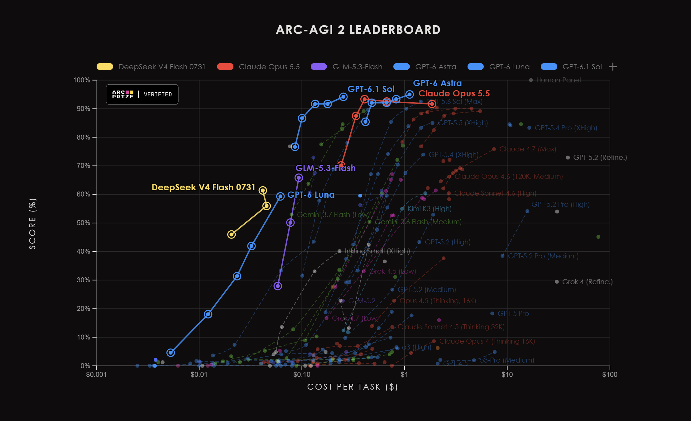

# ARC-explorer



| 推荐 | 验证状态 | 模型 | ARC official / Verified | ARC community 平均值 | ARC 单任务成本 | OpenRouter 目录价格 | 研究日期 | Σ ARC median (%) |
|---|---|---|---:|---:|---:|---:|---:|---:|
| ARC 质量最高但价格高 — thinking 升级 | ✅ | GPT-6.1 Sol | 94.2% | 66.9% (n=1) | ~$0.254 | ~$2/M input；$10/M output | 2026-10-16 | 80.6% |
| Default — 最便宜的有效模型 | ✅ | DeepSeek V4.1 Flash | 72.9% | 69.0% (n=1) | — | ~$0.0357/M input；$0.1428/M output† | 2026-10-16 | 71.0% |
| ARC community candidate | 🟨* | MiMo-V2.6-Flash | — | 66.6% (n=1) | ~$0.003–$0.011 估算* | ~$0.10/M input；$0.28/M output | 2026-10-16 | 66.6% |
| ARC 性价比 / 长 input 替代方案 | ✅ | DeepSeek V4 Flash 0731 | 61.4% | 68.5% (n=1) | ~$0.042 | ~$0.0044/M input；$1.152/M output | 2026-10-16 | 65.0% |
| 通用 agent 兼容性 fallback | ✅ | GPT-6 Luna | 59.3% | 61.3% (n=1) | ~$0.062 | ~$0.10/M input；$0.50/M output | 2026-10-16 | 60.3% |

`✅` ARC Prize Verified 官方结果 · `🟨*` 本表没有 ARC Prize Verified 结果。`ARC official / Verified` 与 `ARC community 平均值` 有意分开。平均值只使用 independent/community 观察结果；`(n=1)` 表示当前只有一个可比观察值，不代表可重复性（[来源](https://www.trustthebench.com/benchmarks/arc-agi-2)）。

`*` 非官方结果没有提供 MiMo 的 ARC 单任务成本。上面的区间是基于 OpenRouter `$0.10/M` input 和 `$0.28/M` output、按每个任务一次请求估算的：20k/4k token 约 `$0.0031`，20k/10k 约 `$0.0048`，100k/4k 约 `$0.0111`（[OpenRouter 价格](https://openrouter.ai/xiaomi/mimo-v2.6-flash-20260921)）。这不是 ARC Prize 官方成本，未计入 retries、tools、ensemble 和 provider overhead。

`Σ ARC median` 是 official 和 community 分数同时存在时的中位数；只有两个值时，中位数与二者的算术平均值相同。只有一项时使用现有分数。它是 ARC 质量指标，不是性价比指标；价格单独列出，以区分质量与运行成本。ARC 单任务成本缺失或不可比时不纳入。V4.1 的 `†` 价格是 OpenRouter 当前折扣/目录价格，可能变化。

机器可读的路由配置：[GitHub last.json](https://github.com/skynes/arc-explorer/blob/main/last.json) · [raw last.json](https://raw.githubusercontent.com/skynes/arc-explorer/main/last.json)

---

用于比较 ARC-AGI-2、社区提交、OpenRouter 经济性、Provider Routing、开放权重模型以及其他推理平台的可复现实验工具集。

项目主要文档使用**英文**：[README.md](README.md)。俄语版本：[README.ru.md](README.ru.md)。

## 项目跟踪内容

1. **ARC Prize Verified**：官方 ARC-AGI-2 semi-private 结果。
2. **Community**：自报结果，与 Verified 分开保存。
3. **Kaggle**：竞赛 submission，不自动等同于单个 API 模型测试。
4. **OpenRouter**：模型目录、provider routing、价格、延迟、吞吐和可用性。
5. **直接 Provider**：DeepInfra、Together、Baseten、Novita、Fireworks、Chutes、SiliconFlow、Groq、Cerebras 等。
6. **开放权重部署**：Hugging Face、GPU 租用、self-host 和 Cocoon。

## 快速开始

需要 Python 3.11+：

```powershell
cd arc-explorer
python -m pip install -r requirements.txt
python scripts/fetch_arc.py
python scripts/fetch_community.py
python scripts/fetch_kaggle.py
python scripts/fetch_openrouter.py --all
python scripts/compare_arc.py
python scripts/compare_openrouter_costs.py
python -m pytest -q
```

`run_openrouter_arc.py` 会记录 score、token usage、cost、provider、retries、错误、延迟和 output tokens/sec。下一步计划加入 streaming TTFT。

## 当前结论

- GPT-6.1 Sol：本表 ARC 质量最高，作为 thinking 升级，但价格较高。
- DeepSeek V4.1 Flash：现在作为 `default`，是当前标准画像下最便宜的有效模型，官方 72.9%、独立结果 69.0%，当前 OpenRouter 价格低于 Luna。
- GPT-6 Luna：保留为通用 agent 兼容性 fallback，适用于更看重可预测 tool workflow 或高 output 经济性的场景。
- DeepSeek V4 Flash 0731：长 input、短 output 的替代方案；input 极便宜，但 output 昂贵。
- MiMo-V2.6-Flash：没有 official 结果的 community 候选；估算价格低，但只有一个 independent 观察值。
- Space Bunny Alpha：匿名 provider 的实验性 free-preview，不推荐用于 production。
- GLM-5.3-Flash：更重视质量时的候选模型。
- 独立 ARC 筛选：GLM 5.3 Flash 是严格不贵于 Luna 的最强付费候选；QwQ 32B 和 Nemotron free 是实验性 backup 候选。
- GPT-6.1 Sol：复杂任务升级模型。
- GPT-OSS-120B：主要的 hosted open-weight 测试候选。
- Qwen3.8-27B：最实际的 self-host pilot 候选。

对 DeepSeek 来说，provider 选择会明显影响价格。当前计算中，当 output 超过 input 的约 4.74% 时，DeepInfra 可能比 OpenRouter default route 更便宜。如果在 OpenRouter 中固定使用 DeepInfra，则 token 价格大致相同，差别主要是 routing、fallback、billing 和 platform overhead。

## 模型选择方法

`default` 和 `thinking` 是路由角色，不是宣称某个模型在所有 workload 中都最好。

- **Default = 最便宜的有效模型。** 本快照的有效性门槛是 `Σ ARC median ≥ 65%`，并且至少有 official 或 independent evidence；community-only/free-preview 结果不进入 production default。在达到门槛的候选中，按标准 `20k input / 4k output` 画像选择估算成本最低者。生产使用前还要重新检查 tool calling、structured output、latency、provider 稳定性和当前价格。
- **Thinking = 高质量升级中最便宜的模型。** 先按 official evidence 选择强质量档；如果接近最高质量的模型明显便宜于绝对最高质量模型，则选择便宜者。因此 `thinking` 仍为 GPT-6.1 Sol：官方 94.2%，ARC 成本显著低于 GPT-6 Astra。
- **条件性路由单独标记。** DeepSeek V4 Flash 0731 在超长 input、极短 output 时可能凭借低 input 价格胜出。Free/community-only 模型在完成 availability、privacy 和可重复性验证前只作为实验选项。

## 研究报告

- [完整 research snapshot](results/research_snapshot_all_2026-10-06.md)
- [ARC official 和 community](results/arc_agi2_results_2026-10-06.md)
- [独立 ARC 候选与 GPT-6 Luna 对比](results/community_arc_candidates_vs_gpt6_luna_2026-10-08.zh-CN.md)
- [ARC official 与 community 平均值 — 2026-10-16](results/arc_agi2_dual_status_2026-10-16.zh-CN.md)
- [搜索与比较方法](results/search_methodology_2026-10-08.zh-CN.md)
- [OpenRouter snapshot](results/openrouter_snapshot_2026-10-06.md)
- [OpenRouter cost test](results/openrouter_cost_test_2026-10-06.md)
- [Decision snapshot](results/decision_snapshot_2026-10-06.md)
- [开放权重模型、HF、GPU 和 Cocoon](results/hosting_alternatives_open_weights_2026-10-06.md)
- [直接 open-weight API providers](results/direct_open_weight_api_providers_2026-10-06.md)
- [DeepInfra 与 OpenRouter 经济性](results/deepseek_deepinfra_vs_openrouter_economics_2026-10-06.md)
- [GPT-6 Luna 与 DeepSeek providers](results/openrouter_provider_comparison_gpt6_luna_deepseek_2026-10-06.md)
- [Default model decision rationale — English](results/default_model_decision_2026-10-06.en.md)
- [当前路由决策 — 2026-10-16](results/default_model_decision_2026-10-16.zh-CN.md)

## 目录结构

```text
config/      模型 aliases 和比较配置
data/        snapshots 以及被 Git 忽略的 live/raw 数据
results/     按日期保存的研究报告
scripts/     数据抓取、比较、成本测试和 ARC runner
tests/       单元测试
```

新的公开文档以英文为主，并提供俄语和简体中文摘要。价格与 provider metrics 必须记录日期和来源 URL。

## 许可证

本项目采用 [MIT License](LICENSE) 发布。

## 贡献

欢迎提交修正、来源更新、Provider 测量、新模型比较和改进建议。请尽量注明数据获取日期、来源 URL、模型/Provider ID，以及可复现结果所需的上下文。
